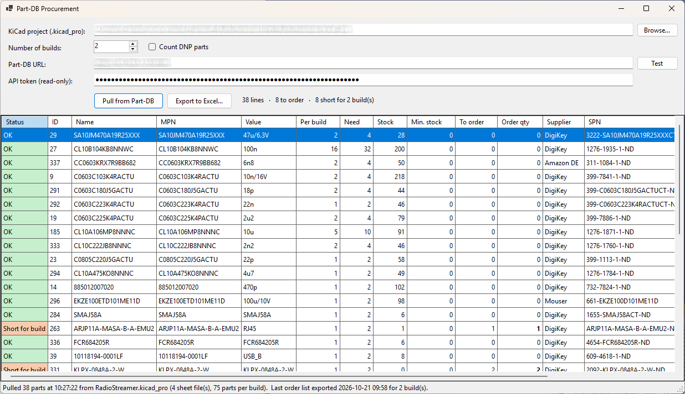
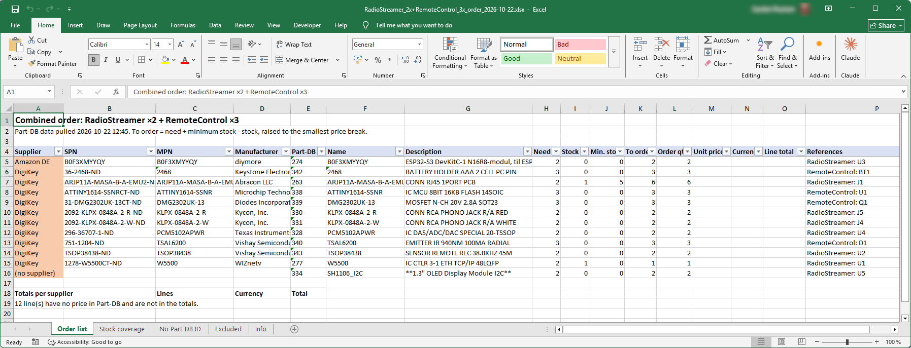

# Part-DB Procurement

**Turn a KiCad schematic into an order list based on live stock in [Part-DB](https://github.com/Part-DB/Part-DB-server).**

You want to build *N* units of a board. What do you need to order so that you can build them *and* still have your minimum stock afterwards?

## Why?

The two obvious routes are both cumbersome:

- **Part-DB projects.** To get a list you first have to create a project in Part-DB and import the BOM, and keep it in sync with every schematic change. Even then, the build view only tells you whether stock covers the build. It ignores minimum stock and doesn't give you an order list.
- **The stock fields in KiCad.** The KiCad HTTP library copies Part-DB's stock into each symbol when the symbol is placed. KiCad only refreshes those values when you run *Update Symbols from Library…* on **all** symbols. That modifies the schematic, so with Git you end up committing yet another, basically unchanged, version of your design just to get current stock numbers. Every stock booking in Part-DB also shows up as a "library symbol mismatch" in the ERC.

This tool avoids both. It reads the KiCad project files directly, without changing them, looks up every part live in Part-DB, and writes an Excel order list grouped by supplier.

<!-- Screenshots: add docs/dialog.png and docs/orderlist.png -->

## Features

- Reads `.kicad_pro` / `.kicad_sch` **directly**. No BOM export from KiCad needed.
- Follows hierarchical sheets, including sheets used more than once, and merges multi-unit symbols.
- Respects **Exclude from BOM** and **DNP**, on symbols as well as on whole sheets. DNP parts can optionally be counted.
- Looks up stock, minimum stock, suppliers, supplier part numbers and price breaks **live** via the Part-DB API.
- **Combines several projects into one purchase**, e.g. a main board and its front panel, each with its own number of builds. A part used by both is ordered once, for the summed need.
- Remembers the **5 most recently used projects** together with their number of builds.
- Calculates **to order = need + minimum stock − stock**, rounded up to the supplier's smallest price break.
- Excel output: order list per supplier with totals, a stock-coverage overview, parts without a Part-DB ID, excluded parts, and run info.
- A **notepad** for things to remember when ordering, such as solder tip tinner or other consumables, with or without an order number. You are reminded on every export and can add them to the order list with the reference `REMEMBER`.
- Warns before you **order twice**: if an order list for the project was already exported, if the schematic changed after the pull, or if the Part-DB data is old.
- Read-only: the tool never changes anything in Part-DB.

## Requirements

- Windows 10/11 with the [.NET 8 Desktop Runtime](https://dotnet.microsoft.com/download/dotnet/8.0)
- KiCad 8 or newer (tested with KiCad 10) using the Part-DB HTTP library, so that symbols carry the `Part-DB ID` field
- Part-DB 2.x with API access (tested with 2.16)

## Getting started

1. Download the latest release from [Releases](https://github.com/carstenpoulsen/PartDbProcurement/releases), or build it yourself (see below).
2. In Part-DB, create an API token: **User settings → API tokens**. A **read-only** token is enough; you can reuse the token you created for KiCad.
3. Start `PartDbProcurement.exe` and fill in:
   - **KiCad projects**: add your `.kicad_pro` file with **Add…**, pick it from **Recent ▾**, or drop it on the list. Add more projects to buy for all of them in one order list; **Remove** (or Del) takes one off.
   - **Builds**: the number of builds of each project. Click the cell and type to change it.
   - **Part-DB URL**, e.g. `http://partdb.local:8080`. The KiCad API URL works too; only scheme, host and port are used.
   - **API token**

   Windows SmartScreen may say *"Windows protected your PC"* on first start, because the exe is not code-signed. Click **More info → Run anyway**.
4. Press **Test** to check the connection, then **Pull from Part-DB**, then **Export to Excel…**.

Changing the number of builds recalculates immediately. Double-click a row to open the part in Part-DB.

Use **Notepad…** to note things to buy next time that are not in a schematic. Ticked items show up in the grid after a pull, and **Export to Excel…** asks whether to put them on the order list.

You can also pass one or more projects on the command line: `PartDbProcurement.exe "C:\path\MyBoard.kicad_pro" "C:\path\Panel.kicad_pro"`.

## How it counts

| Rule | Behaviour |
|---|---|
| Grouping | By the `Part-DB ID` symbol field (spellings like `PartDB ID` are accepted) |
| Power symbols, flags (`#PWR…`) | Ignored |
| Exclude from BOM | Ignored, whether set on the symbol or on a sheet / parent sheet |
| DNP | Ignored unless *Count DNP parts* is ticked; also inherited from sheets |
| Multi-unit symbols (U1A, U1B) | Counted once |
| Sheet used twice | Counted twice, with the real references from KiCad's instance data |
| Symbols without a Part-DB ID | Not dropped: listed on the sheet *No Part-DB ID* |
| Several projects | Same Part-DB ID in several projects: one line, need summed. Parts without an ID are listed per project. |

## How it calculates

| Value | Definition |
|---|---|
| Need | per build × number of builds, summed over the projects of the purchase |
| Stock | Part-DB *total in stock*: all storage locations; expired lots and lots with unknown amount count as 0 |
| To order | need + minimum stock − stock, if positive |
| Order qty | *to order*, raised to the smallest price break of the supplier (MOQ) |
| Supplier | the first non-obsolete supplier entered on the part; other suppliers are listed separately |
| Price | the price break matching the order quantity; no currency conversion, totals per currency |

Status colours: green = OK · yellow = below minimum stock after the build, or stock unknown · red = not enough for the build, or ID not found in Part-DB.

## Settings and security

Settings, the current project list and the recent projects are stored in `%AppData%\PartDbProcurement\settings.json`. The API token is encrypted with Windows DPAPI for the current Windows user. Delete the file, or revoke the token in Part-DB, to remove it.

## Known limitations

- **KiCad 10 design variants are ignored.** The base design is always counted.
- The supplier is not chosen by price; it is the first non-obsolete supplier on the part.
- The "already exported" history is stored on the PC where the tool runs, not shared between users.
- Plain HTTP to Part-DB is accepted. Use HTTPS if Part-DB is reachable outside your own network.
- Windows only (WinForms).

## Building

Open `PartDbProcurement.sln` in Visual Studio 2022 (workload *.NET desktop development*) and build. There are no NuGet dependencies; the Excel file is written directly.

| File | Purpose |
|---|---|
| `Core/SExpr.cs` | KiCad S-expression parser |
| `Core/KiCadBom.cs` | hierarchy walk, exclusions, grouping |
| `Core/PartDbClient.cs` | Part-DB REST API client (read-only) |
| `Core/Procurement.cs` | need / to-order / MOQ / price calculation |
| `Core/XlsxWriter.cs` | dependency-free .xlsx writer |
| `Core/ReportExporter.cs` | workbook layout |
| `MainForm.cs` | the dialog |
| `AppSettings.cs` | settings and DPAPI token storage |

## License

[MIT](LICENSE) © 2026 Carsten Bøgh Poulsen

Not affiliated with the Part-DB or KiCad projects.
